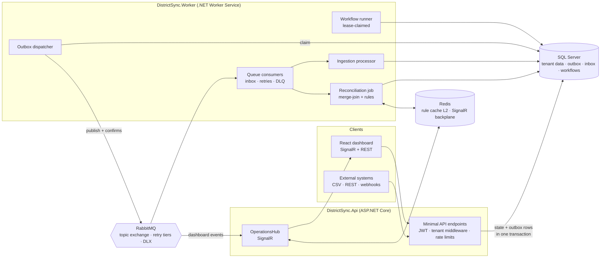

# DistrictSync

**Enterprise data reconciliation and workflow intelligence platform.** Ingests the same business records
from several systems of record (HR, payroll, directories, ERPs), finds where they disagree, lets a
versioned rule engine decide what to do about it, and drives the rest through durable, auditable
human workflows. Built to answer one question well: *how do you make independent systems agree without
anyone copying data by hand?*


> Demo scenario: *Northgate Unified School District* reconciles **employee** records between its HR
> system (system of record), the payroll ERP and the staff directory. The engine itself is
> entity-agnostic; the entity type, match key, comparison profile and rules are all tenant configuration.

---

## What it does

| Capability | How |
|---|---|
| **Multi-source ingestion** | CSV upload (streamed, never buffered), paged REST pull, authenticated webhooks. Schema mapping, normalisation, content hashing and duplicate-upload detection per source. |
| **Reconciliation at scale** | Streaming sort-merge join over match-key-ordered record streams: O(page) memory for millions of rows, checkpointed and resumable. Detects missing, conflicting and duplicate records with field-level diffs. |
| **Configurable rule engine** | A small expression language (`discrepancy.type == "FieldConflict" and fields.only("phone","title")`) with first-match semantics, versioned immutable rule sets, dry-run against real discrepancies, hot reload across workers without redeploy. |
| **Reliable messaging** | Transactional outbox, idempotent inbox (three handler modes), tiered retry queues, dead-letter parking with replay. The same message delivered N times causes exactly one business effect. |
| **Durable workflows** | Lease-claimed workflow instances for SLA escalation and write-back of agreed resolutions; a crashed worker's work resumes elsewhere when the lease lapses. |
| **Concurrency control** | `rowversion` on every aggregate; ETag / `If-Match` on case mutations; explicit conflict-resolution strategies (`PreferNewest`, `PreferHigherTrust`, …) for inter-system disagreement. |
| **Multi-tenancy** | Strongly-typed `TenantId`, EF Core global query filters, a write guard in the unit of work, per-tenant quotas, rate limits and worker concurrency caps. |
| **Live operations** | React + TypeScript console fed by SignalR (Redis backplane): ingestion progress, run statistics, case worklist, dead letters, workflow state. |
| **Observability** | OpenTelemetry traces that cross RabbitMQ (W3C `traceparent` in message headers), custom meters for outbox lag, duplicates, retries, workflow steps; all visible in the Aspire dashboard. |

## Architecture



The solution is a **modular monolith with two deployables** (ADR 0001). Layering is strict and enforced by
tests:

```
DistrictSync.Domain          aggregates, state machines, domain events (no dependencies)
DistrictSync.Contracts       integration events + API DTOs (the wire contract)
DistrictSync.Application     use cases, rule engine, reconciliation engine, ports
DistrictSync.Infrastructure  EF Core/SQL Server, RabbitMQ, Redis, staging, connectors
DistrictSync.Api             HTTP + SignalR host        DistrictSync.Worker   background host
DistrictSync.AppHost         .NET Aspire orchestration  DistrictSync.Web      React dashboard
```

### The seven engineering problems, and where they are solved

| # | Problem | Solution | Code |
|---|---|---|---|
| 1 | Processing an event twice must not duplicate business effects | Inbox table keyed by `(MessageId, Consumer)`; transactional mode runs claim + handler + completion in one DB transaction; long-running mode claims with a heart-beated lease | `Infrastructure/Messaging/MessagePipeline.cs` · [ADR 0003](docs/adr/0003-idempotent-consumers-via-inbox.md) |
| 2 | Reliable SQL Server ↔ RabbitMQ communication | Domain events → outbox rows in the same `SaveChanges`; dispatcher with lease claims and publisher confirms | `Persistence/AppDbContext.cs`, `Messaging/OutboxDispatcher.cs` · [ADR 0002](docs/adr/0002-transactional-outbox.md) |
| 3 | Reconcile millions of records without loading them | Binary-collated match key + keyset pagination + single-pass sort-merge join with checkpoints | `Application/Reconciliation/ReconciliationEngine.cs`, `Persistence/SqlSourceRecordStreamReader.cs` · [ADR 0004](docs/adr/0004-streaming-sort-merge-reconciliation.md) |
| 4 | Conflicting updates from different systems | Stale-write protection at ingestion; `ConflictResolver` strategies; undecidable → human case; rowversion + ETags for user races | `Application/Reconciliation/ConflictResolver.cs` · [ADR 0006](docs/adr/0006-optimistic-concurrency-and-conflict-resolution.md) |
| 5 | Recover long-running workflows after a crash | `WorkflowInstances` with `WakeUpAt` + lease; atomic `UPDATE … OUTPUT` claims; heartbeat; exponential backoff | `Infrastructure/Workflows/WorkflowRunner.cs` · [ADR 0007](docs/adr/0007-durable-workflows-with-leases.md) |
| 6 | Tenant isolation for data and load | Global query filters + write guard + strongly-typed id; quotas, token-bucket rate limits, per-tenant worker semaphores | `Persistence/AppDbContext.cs`, `Infrastructure/TenantWorkLimiter.cs` · [ADR 0005](docs/adr/0005-multi-tenancy.md) |
| 7 | Measure throughput, latency, memory, recovery | OpenTelemetry meters (`districtsync.outbox.lag`, `…messages.duplicates`, `…workflows.failures`), BenchmarkDotNet for the merge-join and rule engine, Testcontainers fault scenarios, a data generator with known expected outcomes | `tests/DistrictSync.Benchmarks`, `tests/DistrictSync.IntegrationTests`, `tools/DistrictSync.DataGen` |

## Quick start

Prerequisites: [.NET 10 SDK](https://dotnet.microsoft.com/download), Docker (running), Node 20+.

```bash
# 0. one-time: dashboard dependencies
(cd src/DistrictSync.Web && npm install)

# 1. one command starts SQL Server, RabbitMQ, Redis, the API, the worker and the React dashboard
dotnet run --project src/DistrictSync.AppHost
```

The Aspire dashboard opens with links to every resource. The API applies migrations and seeds the demo
tenant (`northgate`) with three source systems, a comparison profile and a published rule set.

```bash
# 2. push the sample data through the whole pipeline and watch the dashboard react
scripts/demo.sh http://localhost:5080
```

Sign in to the web dashboard with tenant `northgate`, any user id and the roles you want to try
(`admin`, `analyst`, `approver`, `viewer`). API reference: `http://localhost:5080/scalar`.

### Generate a large data set

```bash
dotnet run --project tools/DistrictSync.DataGen -- --rows 1000000 --out samples/generated --seed 42
```

The generator prints the expected number of each discrepancy type so a run's statistics can be verified.

## The rule language

Rules are evaluated in order; the first whose condition is true decides the action
(`AutoResolve <strategy>`, `OpenCase <priority> [role]`, `Ignore`). No match → a Normal-priority case.

```text
discrepancy.type == "FieldConflict" and fields.only("phone", "title", "department")   → AutoResolve PreferNewest
discrepancy.type == "FieldConflict" and fields.any("salary", "status")                 → OpenCase High payroll
discrepancy.type == "MissingInRight" and left.status == "Terminated"                   → Ignore
discrepancy.type == "MissingInRight" and daysSince(left.hireDate) <= 30                → OpenCase Urgent payroll
diff(left.salary, right.salary) > 5000 or source.left.trustRank < source.right.trustRank
```

Facts: `discrepancy.{type,severity,matchKey,entityType,differenceCount}`, `fields` (names that differ),
`diff.<field>.{left,right,critical}`, `left.<field>` / `right.<field>` (+ `_exists`, `_updatedAt`),
`source.{left,right}.{code,trustRank}`. Operators: `== != < <= > >= and or not in contains startsWith
endsWith matches`. Functions: `len lower upper trim abs number coalesce daysSince hoursSince diff`;
list methods `any all only none count`. Validate with `POST /api/v1/rules/validate`; try a set against a
real discrepancy with `POST /api/v1/rules/sets/{id}/dry-run`.

## Testing

| Suite | What it proves | Needs |
|---|---|---|
| `tests/DistrictSync.UnitTests` (125 tests) | Rule language (lexer/parser/evaluator), rule engine, normaliser, field comparer, merge-join (incl. 50k-row stream), conflict resolver, every domain state machine | nothing |
| `tests/DistrictSync.ArchitectureTests` (7 tests) | Layer dependencies, sealed events, event catalogue completeness | nothing |
| `tests/DistrictSync.IntegrationTests` (9 scenarios) | Full stack via Testcontainers: CSV → outbox → worker → rules → cases → write-back; duplicate delivery = one effect; poison message → dead letter; crashed-worker workflow recovery; tenant isolation; stale ETag → 412; outbox drains | Docker |
| `tests/DistrictSync.Benchmarks` | Merge-join throughput/allocations at 100k and 1M rows; rule evaluation cost | `dotnet run -c Release` |

```bash
dotnet test tests/DistrictSync.UnitTests
dotnet test tests/DistrictSync.ArchitectureTests
dotnet test tests/DistrictSync.IntegrationTests        # starts SQL Server, RabbitMQ and Redis containers
dotnet run -c Release --project tests/DistrictSync.Benchmarks -- --filter '*MergeJoin*'
```

## Benchmarks

`tests/DistrictSync.Benchmarks`, BenchmarkDotNet 0.15.8, Release, Apple M3, .NET 10.0.14. The merge-join
benchmark streams two in-memory, match-key-ordered sides (left: N rows; right: N minus 1% missing, 2%
field conflicts, 5% formatting-only differences) through `ReconciliationEngine` and counts non-matches.
This isolates the algorithm from SQL I/O; the keyset reader adds about one round-trip per 5,000 rows.

| Rows per side | Comparison | Mean | Allocated |
|---|---|---|---|
| 100,000 | 6-field profile with normalizers | 184.8 ms | 567 MB |
| 100,000 | all fields, trim semantics | 184.9 ms | 609 MB |
| 1,000,000 | 6-field profile with normalizers | 1,866 ms | 5,698 MB |
| 1,000,000 | all fields, trim semantics | 1,855 ms | 6,111 MB |

Reading: about **1.07 million records per second** on one core, and a 10× larger input costs 10.1× the
time, so the pass is linear as designed. Live memory stays bounded (one key-group per side), but the
allocation column shows the next optimisation: every comparison parses both JSON payloads into
`JsonNode` graphs (~5.7 KB of short-lived garbage per row pair). Comparing with `Utf8JsonReader`, or
storing normalised attributes in a columnar shape, would cut that by an order of magnitude. Reproduce with:

```bash
dotnet run -c Release --project tests/DistrictSync.Benchmarks -- --filter '*MergeJoin*'
```

## Project layout

```
src/
  DistrictSync.Domain/           Tenants · Sources · Ingestion · Reconciliation · Rules · Cases · Workflows
  DistrictSync.Contracts/        Events (EventCatalog = wire names) · Api DTOs
  DistrictSync.Application/      Rules/Dsl (language) · Reconciliation (engine, job) · Ingestion · Cases · Workflows
  DistrictSync.Infrastructure/   Persistence (EF Core, migrations) · Messaging (RabbitMQ) · Workflows · Sources · Staging
  DistrictSync.Api/              Endpoints · Auth · Hubs · Middleware
  DistrictSync.Worker/           Host wiring for consumers, outbox dispatcher, workflow runner
  DistrictSync.ServiceDefaults/  OpenTelemetry, health checks, resilience
  DistrictSync.AppHost/          Aspire orchestration
  DistrictSync.Web/              React + TypeScript dashboard (Vite, TanStack Query, SignalR, Recharts)
tests/                           UnitTests · IntegrationTests · ArchitectureTests · Benchmarks
tools/DistrictSync.DataGen/      synthetic data with planted anomalies
docs/adr/                        architecture decision records
samples/, scripts/               demo data and end-to-end demo script
```

## Technology

C# 14 / .NET 10 · ASP.NET Core minimal APIs · Entity Framework Core 10 · SQL Server · RabbitMQ 4
(RabbitMQ.Client 7) · Redis (HybridCache L2, SignalR backplane) · SignalR · .NET Aspire 13 ·
OpenTelemetry · xUnit v3 · Shouldly · Testcontainers · NetArchTest · BenchmarkDotNet · React 18 ·
TypeScript · Vite · TanStack Query · Recharts · Tailwind CSS · GitHub Actions.

## Status and roadmap

Working end to end locally and under CI. Reasonable next steps, in order of value:

1. Real write-back connectors (the `IWriteBackConnector` port currently has a simulated implementation).
2. `SqlBulkCopy` + `MERGE` ingestion path for sustained multi-million-row loads.
3. Incremental reconciliation triggered by webhook deltas instead of full runs.
4. OpenID Connect against a real identity provider in place of development tokens.
5. Blob-storage staging and a Kubernetes manifest via `aspire publish`.

## License

MIT
